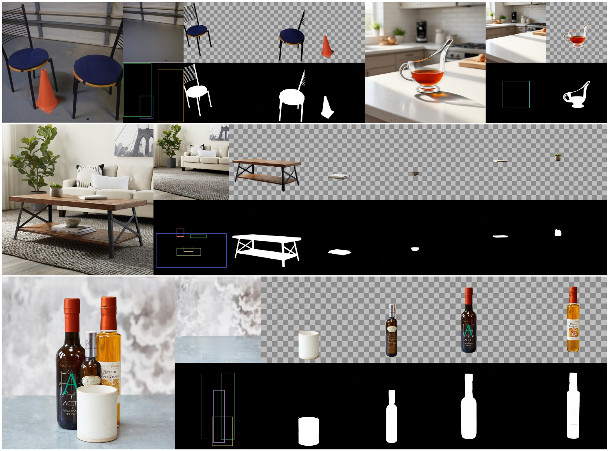
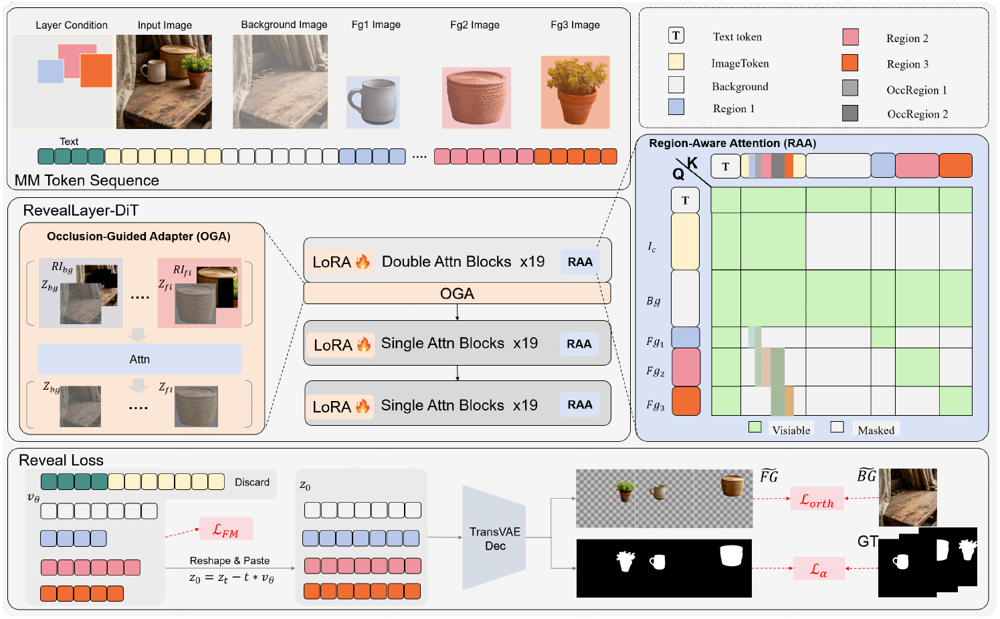

# TBG RevealLayer

*occlusion-aware image decomposition.*

Turn one flattened image into separate RGBA layers using [RevealLayer](https://github.com/360CVGroup/RevealLayer), with an optional native text-grounding prepass to select the objects. The pack contains **one custom node**. ComfyUI's native loaders, box editor, and optional SAM3 detector supply the rest of the workflow.

*Official upstream model examples, credited to the RevealLayer authors; these are not results generated by this custom node.*

## Install and run

1. Put this repository folder inside `ComfyUI/custom_nodes/` and restart ComfyUI.
2. Import [TBG_RevealLayer_Manual.json](workflows/TBG_RevealLayer_Manual.json) or [TBG_RevealLayer_Grounded.json](workflows/TBG_RevealLayer_Grounded.json).
3. Select your image and existing native FLUX.1-dev, CLIP-L/T5XXL, and FLUX VAE files.
4. Draw object boxes, or use the optional grounded workflow with an existing local SAM3.1 checkpoint.
5. Queue the workflow. Missing extension requirements and RevealLayer checkpoint files are handled on first execution.

If requirements were installed or updated, the node asks for one ComfyUI restart before retrying. ComfyUI Manager can install [requirements.txt](requirements.txt) ahead of time. PyTorch/CUDA and ComfyUI's own model-loader dependencies remain supplied by ComfyUI.

Both workflows include a **Markdown instructions node** with setup steps and clickable links for every model. See the same [workflow guide](workflows/README.md) here.

## Automatic RevealLayer checkpoint setup

The first execution downloads only the four RevealLayer files, approximately **697 MB**, from [qihoo360/RevealLayer](https://huggingface.co/qihoo360/RevealLayer). Files are stored inside this node folder:

    models/reveallayer/
    ├── pytorch_lora_weights.safetensors
    ├── layer_pe.pt
    ├── Refiner.pt
    └── xvae/transparent_decoder_ckpt.pth

Downloads use a pinned upstream revision, SHA-256 verification, an atomic final-file replacement, and resumable partial files. Verified files are reused. ComfyUI displays download progress. For offline installation, copy the four files into these locations; their direct links are in the workflow guide.

The node applies the RevealLayer LoRA internally at strength 1.0. Connect the base FLUX model without applying the same LoRA again.

**Grounding is optional. This pack never downloads a grounding model.** The native FLUX, CLIP, and VAE files are also selected through their normal loaders and are not downloaded by this pack.

## Manual boxes or optional text grounding

The manual workflow uses **Create Bounding Boxes → TBG RevealLayer**. The box editor dimensions come from Get Image Size so the boxes use original-image pixel coordinates.

The grounded workflow uses native **SAM3 checkpoint loader → CLIP Text Encode → SAM3 Detect → Create Bounding Boxes → TBG RevealLayer**. Select an existing `sam3.1_multiplex_fp16.safetensors` file. Text such as `person:2` requests up to two people; native SAM3 supports several categories, for example `person:2, handbag:1`. Review and edit the boxes in the native editor, then requeue. The manual workflow loads no SAM3 model.

The actual RevealLayer checkpoint uses its fixed decomposition instruction. The optional grounding model interprets the user's object description and supplies spatial boxes; box metadata text is not passed to RevealLayer as a prompt.

## Minimal node interface

**Required connections:** `model`, `clip`, `vae`, `image`.

**Optional connection:** `bounding_boxes` — a normal visible `BOUNDING_BOX` input containing pixel-space `x`, `y`, `width`, and `height` dictionaries. A single frame broadcasts across an image batch; a matching box-frame batch supplies each image's own regions. The only hidden value is ComfyUI's internal node ID for progress reporting.

| Setting | Meaning |
|---|---|
| `steps` | Denoising steps; start at 30. |
| `guidance_scale` | FLUX guidance embedding; default 1.0. CFG mixing remains 3.5, matching upstream. |
| `seed` | Starting seed; successive images use successive seeds. |
| `max_layers` | Total layer limit, including two reserved slots; maximum 12. |
| `resize_output_to_input` | Restore the returned layers to the input image dimensions. |

There are no coordinate text fields, coordinate-format selectors, or checkpoint-path fields. Two slots are reserved for foreground and background: three total layers allow one object box, four allow two, and twelve allow ten. Excess boxes are skipped in input order with a log message.

## Outputs

| Output | Contents |
|---|---|
| `foreground_rgba` | Foreground RGBA layer. |
| `background_rgba` | Reconstructed background RGBA layer. |
| `object_layers_rgba` | Selected object RGBA layers in box order. |
| `object_masks` | Object alpha masks. |
| `all_layers_rgba` | All returned layers in RevealLayer order. |
| `composite_rgba` | Alpha-composite of the returned layers. |

No object boxes produces a transparent placeholder on the object outputs. The model works at a 1024-pixel long side with dimensions aligned to 16; resizing back to a larger input does not add detail.

## Compatibility and validation

Use standard guidance-embedded **FLUX.1-dev** in FP16, BF16, or FP32, its matching CLIP-L/T5 encoders, and a 16-channel, 8× FLUX VAE. FLUX.2, quantized transformer weights, and scheduled CLIP conditioning are not supported. The grounded workflow additionally needs native `SAM3_Detect` support in ComfyUI.

The node runs its RevealLayer-specific sampling loop inside the custom node, reporting native ComfyUI step progress and checking interruption. It does not currently expose native KSampler sampling. All integration files remain inside this custom-node folder.

The decoder-range quality fix and upstream 512-token T5 conditioning are retained. Controlled actual-checkpoint reconstruction improved from 18.8 to 37.1 dB PSNR at 1024 × 432 after correcting the decoder range. This is a decoder reconstruction measurement, not a claim about generated-layer quality. See [development and validation notes](docs/DEVELOPMENT.md) for current test evidence and remaining GPU validation.

Older `RevealLayerDecompose` workflows must replace that node with **TBG RevealLayer**; use the updated workflows included here.

## Thanks and original research

Thank you to **360 AI Research**, **Wenzhou University**, and the RevealLayer authors — Binhao Wang, Shihao Zhao, Bo Cheng, Qiuyu Ji, Yuhang Ma, Liebucha Wu, Shanyuan Liu, Dawei Leng, and Yuhui Yin — for the research and public inference project. Thank you to **qihoo360** for publishing the checkpoint, and **Meta / Comfy-Org** for the optional native SAM3 grounding path.

- [Original RevealLayer GitHub project](https://github.com/360CVGroup/RevealLayer)
- [Official RevealLayer checkpoint](https://huggingface.co/qihoo360/RevealLayer)
- [Project page](https://360cvgroup.github.io/RevealLayer/)
- [Paper: arXiv:2605.11818](https://arxiv.org/abs/2605.11818)
- [SAM3 research and source](https://github.com/facebookresearch/sam3)

RevealLayer framework and citation

    @inproceedings{wang2026reveallayer,
      title={RevealLayer: Disentangling Hidden and Visible Layers via Occlusion-Aware Image Decomposition},
      author={Wang, Binhao and Zhao, Shihao and Cheng, Bo and Ji, Qiuyu and Ma, Yuhang and Wu, Liebucha and Liu, Shanyuan and Leng, Dawei and Yin, Yuhui},
      booktitle={International Conference on Machine Learning},
      year={2026}
    }

This is an independent integration. Original integration code uses the [MIT license](LICENSE); adapted model code and copied upstream visual assets retain their upstream notices. See [NOTICE.txt](NOTICE.txt) and [third-party asset credits](assets/upstream/THIRD_PARTY_NOTICES.md). Downloaded models retain their own licenses and are excluded from source control.
